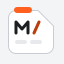
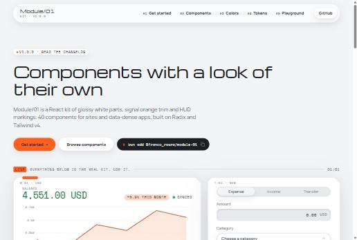

<p align="center">
  
</p>

<h1 align="center">Module/01</h1>

<p align="center">
  <b>React components for a gadget you'd want on your desk.</b><br>
  Glossy white parts, signal orange trim, soft corners with one hard notch, and HUD markings.<br>
  A component kit for any app or website.
</p>

<p align="center">
  <a href="https://www.npmjs.com/package/@franco_roura/module-01"></a>
  
  
  
</p>

<p align="center">
  <a href="https://franco-roura.github.io/module-01/"></a>
</p>

## Contents

- [Why Module/01](#why-module01)
- [Installed in a minute](#installed-in-a-minute)
- [Only ship what you use](#only-ship-what-you-use)
- [Tokens you can write with](#tokens-you-can-write-with)
- [Forms that flow, faults you can feel](#forms-that-flow-faults-you-can-feel)
- [Every component, live](#every-component-live)
- [Contributing](#contributing)
- [Security and license](#security-and-license)

## Why Module/01

<table>
  <tr>
    <td width="50%" valign="top">
      <b>A look of its own</b><br>
      Molded shells, one chamfered corner per part, hinge tabs, tick rulers and crosshairs. It
      doesn't look like every other kit.
      <a href="https://franco-roura.github.io/module-01/components/">Gallery →</a>
    </td>
    <td width="50%" valign="top">
      <b>Small where it counts</b><br>
      One ESM file per component and four entry points, so a Button and a Panel cost about 10 kB.
      <a href="https://franco-roura.github.io/module-01/getting-started/">Entry points →</a>
    </td>
  </tr>
  <tr>
    <td valign="top">
      <b>Tailwind v4 native</b><br>
      Import one stylesheet and the tokens become utilities in your own markup. No Tailwind? A
      precompiled stylesheet ships too.
      <a href="https://franco-roura.github.io/module-01/colors/">Colors →</a>
    </td>
    <td valign="top">
      <b>Accessible underneath</b><br>
      Radix primitives handle focus, keyboard and screen readers. Text pairs are checked at 4.5:1.
      <a href="https://franco-roura.github.io/module-01/components/">Components →</a>
    </td>
  </tr>
  <tr>
    <td valign="top">
      <b>Built for real screens</b><br>
      Dashboards, forms, dialogs, money and charts for apps; heroes, timelines, media cards and
      calls to action for websites.
      <a href="https://franco-roura.github.io/module-01/components/">Components →</a>
    </td>
    <td valign="top">
      <b>Documented like a product</b><br>
      Guidelines for every component say what to provide and when to use it, next to live examples
      you can edit.
      <a href="https://franco-roura.github.io/module-01/playground/">Playground →</a>
    </td>
  </tr>
</table>

## Installed in a minute

```bash
bun add @franco_roura/module-01
```

Import the theme after Tailwind, then use a component:

```css
@import "tailwindcss";
@import "@franco_roura/module-01/theme.css";
```

```tsx
import { Button, Field, Input, Panel, SectionHeader } from "@franco_roura/module-01";

export function NewWallet() {
  return (
    <Panel serial="W-01 · NEW" cross>
      <SectionHeader as="h2" code="S-01" label="Wallets" title="Add wallet" />
      <Field label="Name" htmlFor="wallet-name">
        <Input id="wallet-name" placeholder="Savings" />
      </Field>
      <Button arrow>Save</Button>
    </Panel>
  );
}
```

It needs React 19. Not on Tailwind? Import `@franco_roura/module-01/styles.css` instead.

**[Read more: setup, fonts and server components →](https://franco-roura.github.io/module-01/getting-started/)**

## Only ship what you use

The kit is split so heavy dependencies stay out of apps that don't need them, and every entry
tree-shakes down to the components you import.

| Import                            | What's in it                                                     |
| --------------------------------- | ---------------------------------------------------------------- |
| `@franco_roura/module-01`         | Panels, HUD markings, buttons, forms, pickers, dialogs and menus |
| `@franco_roura/module-01/finance` | Amounts, money input, FX converter, budget meter, category icons |
| `@franco_roura/module-01/charts`  | Balance, cash flow and donut charts (needs `recharts`)           |
| `@franco_roura/module-01/site`    | Hero, experience timeline, project cards, contact block, footer  |

Bundle sizes are budgeted in CI, so a change that makes the kit heavier fails its pull request.

**[Read more: entry points →](https://franco-roura.github.io/module-01/getting-started/)**

## Tokens you can write with

Colors, type, spacing, radii, notches and shadows come from one `tokens.json`, each with a note on
how to use it. With the theme imported they are Tailwind utilities, so your own markup stays in the
system: `bg-shell`, `text-ink-soft`, `rounded-lg`, `notch-md`, `shadow-float`, `hud`.

Colors come as four palettes of ten steps (graphite, signal, green, red) and named tokens that
point into them, so retheming is a matter of overriding a few custom properties.

**[Read more: colors →](https://franco-roura.github.io/module-01/colors/)** ·
**[tokens →](https://franco-roura.github.io/module-01/tokens/)**

## Forms that flow, faults you can feel

Forms built from the kit move focus the way people fill them in. Dialogs and sheets open on their
first field, and a pick in a Select, Combobox or DatePicker moves on to the next one. When a field
is rejected, call `fault(id)`: the control jitters like a servo, pings once in danger and takes
focus.

**[Read more: form flow →](https://franco-roura.github.io/module-01/components/combobox/)** ·
**[fault feedback →](https://franco-roura.github.io/module-01/components/field/)**

## Every component, live

The docs have a page per component with live examples, a props table read from the types, and the
guidelines. Any example opens in a playground with the whole kit in scope.

**[Open the docs →](https://franco-roura.github.io/module-01/)**

## Contributing

Bug reports, fixes and new components are welcome. You need [Bun](https://bun.sh) and Node.js 24.

```bash
bun install
```

```bash
bun run dev
```

**[Read more: CONTRIBUTING.md →](CONTRIBUTING.md)**

## Security and license

Report vulnerabilities privately, as described in [SECURITY.md](SECURITY.md).

Module/01 is licensed under either of [MIT](LICENSE-MIT) or [Apache-2.0](LICENSE-APACHE), at your
option. The fonts it names (Michroma, Manrope and Space Mono) are not bundled; each is under the
SIL Open Font License.
